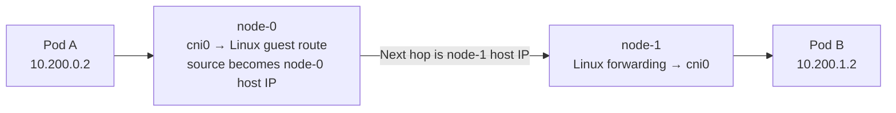
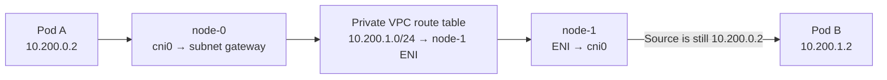
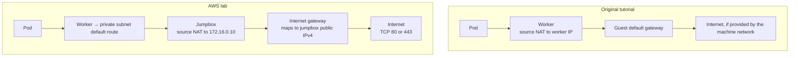
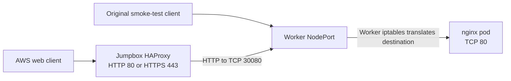

# Traffic routing in the original tutorial and the AWS lab

The original two-worker tutorial installs pod routes in the Linux guests with `ip route add`. The AWS lab installs the same destination prefixes in the VPC route tables with Terraform. This comparison uses the upstream two-worker edition that the lab extends. An older Google Cloud edition also used VPC routes, provisioned with `gcloud`. [Upstream two-worker tutorial](https://github.com/kelseyhightower/kubernetes-the-hard-way/blob/master/docs/11-pod-network-routes.md) · [Older Google Cloud edition](https://github.com/kelseyhightower/kubernetes-the-hard-way/blob/79a3f79/docs/11-pod-network-routes.md)

## Pod-to-pod traffic

In both setups, the CNI bridge is called `cni0`. Each worker assigns pod IPs from its own range, `10.200.0.0/24` on `node-0` and `10.200.1.0/24` on `node-1`. Pods on the same worker exchange traffic over the local bridge. A packet for a pod on the other worker goes through the sending worker's Linux IP forwarding path. [Bridge configuration](../configs/10-bridge.conf) · [CNI bridge documentation](https://www.cni.dev/plugins/current/main/bridge/)

### Original tutorial

On `node-0`, the guest route for `10.200.1.0/24` uses `node-1`'s host IP as its next hop. `node-1` has the mirror route, and `server` has a guest route for each worker's pod subnet. The destination worker forwards the packet to its local bridge. The upstream bridge config sets `ipMasq: true`. With the lab's CNI version, a new direct connection initiated by a pod to the other worker's pod subnet is masqueraded on the sending worker. The receiving pod sees the worker IP as the source, and replies go back through that worker's NAT state. The guest route still matches the destination pod IP. [Upstream routes](https://github.com/kelseyhightower/kubernetes-the-hard-way/blob/master/docs/11-pod-network-routes.md) · [Upstream bridge config](https://github.com/kelseyhightower/kubernetes-the-hard-way/blob/master/configs/10-bridge.conf) · [CNI v1.6.2 masquerade rules](https://github.com/containernetworking/plugins/blob/v1.6.2/pkg/ip/ipmasq_iptables_linux.go#L38-L87)

### AWS lab

The guest sends the packet to its usual subnet gateway. AWS looks up the destination pod IP and sends the packet to the owning worker's elastic network interface (ENI). Both the public and private subnet route tables have these pod routes, so traffic can reach a pod from either subnet. The `/24` pod route wins over the private subnet's `0.0.0.0/0` route to the jumpbox. [AWS route provisioning](11-pod-network-routes.md#aws-infrastructure-add-on-pod-routes) · [Terraform routes](../infrastructure/terraform/main.tf) · [AWS route selection](https://docs.aws.amazon.com/vpc/latest/userguide/subnet-route-tables.html)

`AWS_HYBRID=true` writes `ipMasq: false` to the worker bridge config, so Pod B sees `10.200.0.2` as the source and replies to that IP through the reverse VPC route. Linux IP forwarding moves packets between `cni0` and the worker's network interface. Disabling EC2 source/destination checks allows that interface to carry packets addressed to or sourced from pods. [AWS worker setup](09-bootstrapping-kubernetes-workers.md#configure-cni-networking) · [AWS lab topology](../infrastructure/terraform/README.md)

## Pod-to-internet traffic

The original tutorial's bridge masquerades outbound pod traffic on the worker. The worker then uses its normal default gateway, and any public IP translation beyond it depends on the machine network. On AWS, the private subnet's default route sends outbound traffic to the jumpbox ENI. For internet-bound TCP ports 80 and 443, jumpbox `nftables` masquerades the pod IP to the jumpbox's private IP. The AWS internet gateway maps that private IP to the jumpbox's public IPv4 address. On the return path, the jumpbox reverses its translation and the public subnet's pod route sends the packet back to the owning worker. [Jumpbox forwarding and NAT rules](../infrastructure/terraform/jumpbox/bootstrap.sh.tftpl) · [AWS internet gateway translation](https://docs.aws.amazon.com/vpc/latest/userguide/VPC_Internet_Gateway.html#ip-addresses-nat)

## Client-to-Service traffic

The original smoke test curls the worker's IP or hostname on the assigned NodePort. The AWS smoke test adds a public web entry point. Clients connect to the jumpbox on port 80 or 443, and HAProxy opens a separate HTTP connection to a healthy worker on port `30080`. `externalTrafficPolicy: Local` limits the NodePort to local endpoints, so HAProxy's TCP health check selects a worker with a local nginx pod. In both setups, `kube-proxy` programs the worker's `iptables` rules to translate the NodePort destination to the selected pod's IP and port. [Original smoke test](https://github.com/kelseyhightower/kubernetes-the-hard-way/blob/master/docs/12-smoke-test.md#services) · [AWS NodePort smoke test](12-smoke-test.md#services) · [HAProxy configuration](../infrastructure/terraform/jumpbox/bootstrap.sh.tftpl) · [kube-proxy configuration](../configs/kube-proxy-config.yaml)

