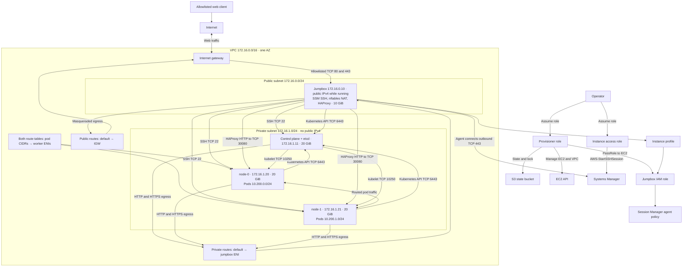

# Kubernetes The Hard Way on AWS

Start here if you've just cloned the repository and want to run the tutorial on AWS. Terraform creates four Debian 12 EC2 instances and their network. You still install and configure Kubernetes by hand.

The setup has three parts. `project-account/` creates a long-lived AWS Organizations member account. `state-bucket/` creates the bucket and roles inside that account. The Terraform configuration in this directory creates the lab. You can tear down the lab between sessions and keep the account, bucket, and roles for next time.

If your team already created a project account for this checkout, stop before step 1 and see [Use an existing deployment](#use-an-existing-deployment).

## Before you start

- Install Terraform 1.10 or later, GNU Make, Python 3, AWS CLI v2, and OpenSSH. Install the AWS CLI Session Manager plugin before connecting to the jumpbox.
- Sign in with an AWS CLI profile that can create member accounts in the **AWS Organizations management account**. Administrator access in a member account alone is insufficient. This guide assumes an existing organization and uses `us-east-1`.
- Have an email address you control that AWS has never registered to another account. Reusing the management account email returns `EMAIL_ALREADY_EXISTS`.
- Know the IAM ARN of the user or role behind your admin login. You'll use it to let that principal assume the project's Terraform and SSH roles.

Run the commands below from `infrastructure/terraform`:

```sh
cd infrastructure/terraform
```

## 1. Create the project account

Use a separate CLI profile called `kthw-management` for the management login. Add this block to your normal AWS config (typically `~/.aws/config`). Replace `YOUR_ADMIN_PROFILE` with the name of your existing authenticated profile, such as `default`. This helper lets Terraform use the same temporary credentials as the AWS CLI.

```ini
[profile kthw-management]
credential_process = aws --profile YOUR_ADMIN_PROFILE configure export-credentials --format process
```

Verify the login. The `Account` from the first command should match the management account ID from the second.

```sh
aws --profile kthw-management sts get-caller-identity
aws --profile kthw-management organizations describe-organization \
  --query 'Organization.MasterAccountId' --output text
```

Create `project-account/account.auto.tfvars` with your management account ID and unused email:

```hcl
management_account_id = "YOUR_MANAGEMENT_ACCOUNT_ID"
project_account_email = "YOUR_UNUSED_EMAIL"
```

```sh
AWS_PROFILE=kthw-management terraform -chdir=project-account init
AWS_PROFILE=kthw-management terraform -chdir=project-account plan -out=tfplan
```

Review the plan. When it shows only the new member account, apply it and save the returned account ID.

```sh
AWS_PROFILE=kthw-management terraform -chdir=project-account apply tfplan
terraform -chdir=project-account output -raw project_account_id
```

The account has Terraform's `prevent_destroy` protection. Organizations creates the `OrganizationAccountAccessRole` used for the next step.

## 2. Set up the project roles and state bucket

Add these profiles to the same AWS config. Replace every `PROJECT_ACCOUNT_ID` with the account ID from step 1.

```ini
[profile kthw-bootstrap]
role_arn = arn:aws:iam::PROJECT_ACCOUNT_ID:role/OrganizationAccountAccessRole
source_profile = kthw-management

[profile kthw-provisioner]
role_arn = arn:aws:iam::PROJECT_ACCOUNT_ID:role/kubernetes-hard-way-provisioner
source_profile = kthw-management

[profile kthw-instance-access]
role_arn = arn:aws:iam::PROJECT_ACCOUNT_ID:role/kubernetes-hard-way-instance-access
source_profile = kthw-management
```

| Profile | Use |
| --- | --- |
| `kthw-management` | Create the member account in AWS Organizations. |
| `kthw-bootstrap` | Administer the member account and create the bucket and project roles. |
| `kthw-provisioner` | Run Terraform for the lab. This is the profile used by both the S3 backend and the AWS provider. |
| `kthw-instance-access` | Open an SSH tunnel to the jumpbox through Session Manager. |

Create `state-bucket/account.auto.tfvars` with the same member account ID, a globally unique S3 bucket name, and your management IAM principal ARN. Use the IAM ARN beginning with `arn:aws:iam::`. If `get-caller-identity` showed an assumed-role session ARN, use the underlying IAM role ARN, including its path if it has one.

```hcl
project_account_id    = "PROJECT_ACCOUNT_ID"
bucket_name           = "kubernetes-hard-way-PROJECT_ACCOUNT_ID-tfstate"
trusted_principal_arn = "YOUR_MANAGEMENT_IAM_PRINCIPAL_ARN"
```

The trusted principal also needs permission to assume the cross-account roles. Verify that `kthw-bootstrap` resolves to the member account, then review and apply the bootstrap plan. If the account was just created, allow a short time for its bootstrap role to become available.

```sh
aws --profile kthw-bootstrap sts get-caller-identity
AWS_PROFILE=kthw-bootstrap terraform -chdir=state-bucket init
AWS_PROFILE=kthw-bootstrap terraform -chdir=state-bucket plan -out=tfplan
AWS_PROFILE=kthw-bootstrap terraform -chdir=state-bucket apply tfplan
terraform -chdir=state-bucket output -raw backend_config > lab.s3.tfbackend
```

This creates a private, encrypted, versioned bucket with S3 lock files enabled in the lab backend. The bucket policy denies direct object access to principals other than the provisioner. The bootstrap administrator can edit the policy for recovery. The provisioner manages the lab's EC2 and VPC resources in the configured region. Keep routine access in the project account limited to the roles intended for it.

Back up `project-account/terraform.tfstate` and `state-bucket/terraform.tfstate` in a secure location separate from the lab's state bucket. Git ignores these two local state files, your `*.auto.tfvars`, and the generated `lab.s3.tfbackend`. The lab state itself lives in S3 under `kubernetes-hard-way/terraform.tfstate`.

## 3. Deploy the lab

Create `account.auto.tfvars` in this directory with the member account ID. To enable public HTTP and HTTPS, add the public IPv4 CIDR of each client. Replace the documentation address below with your own public address and use `/32` for a single client. Omit the setting to keep public ingress closed.

```hcl
project_account_id    = "PROJECT_ACCOUNT_ID"
budget_alert_email    = "YOUR_ALERT_EMAIL"
ingress_allowed_cidrs = ["203.0.113.10/32"]
```

Create and load a dedicated local key. Loading it allows the jumpbox to use SSH agent forwarding for the initial connection to each private node.

```sh
ssh-keygen -t ed25519 -f "$HOME/.ssh/kthw_ed25519" -C "kubernetes-hard-way"
ssh-add "$HOME/.ssh/kthw_ed25519"
export TF_VAR_ssh_public_key="$(cat "$HOME/.ssh/kthw_ed25519.pub")"
aws --profile kthw-provisioner sts get-caller-identity
```

If necessary, start an SSH agent before running `ssh-add`. Use the same public key when running Terraform again. Confirm the provisioner is in the member account. If you choose a different region, set the lab's `aws_region` and the bootstrap's `lab_region` to match.

From the repository root, run `make up`. This initializes the existing S3 backend, creates and applies a fresh plan, and starts any stopped lab instances. It refuses plans that delete or replace instances or EBS volumes. To review a first deployment before making changes, initialize the backend and run `terraform plan` in this directory first. The plan should show one `t3.micro`, three `t3.small`, 70 GiB of encrypted gp3 storage, and only the jumpbox configured for a public address.

The lab configuration creates an account-wide $50 monthly AWS cost budget with actual-spend email alerts at 80% and 90%. It includes bootstrap costs and other account charges; it does not stop spending. The budget is removed when the lab is destroyed. Resources that support tags receive `Cost = lab` or `Cost = bootstrap`; activate the `Cost` tag in AWS Billing to use it for cost allocation. Existing deployments must apply the updated `state-bucket` configuration first to grant the provisioner budget permissions.

## 4. Connect and install Kubernetes

Allow time for cloud-init to install SSM Agent, nftables and HAProxy. Run the following commands from the repository root on your workstation.

If your lab profiles are in `infrastructure/terraform/project.awsconfig`, select that file in the terminal you will use to connect. Run the export again in each new terminal that needs those profiles. If Terraform reports `failed to get shared config profile, kthw-provisioner`, check that your terminal is using the AWS config file that defines that profile.

```sh
export AWS_CONFIG_FILE="$PWD/infrastructure/terraform/project.awsconfig"
```

Connect as Debian's `admin` user through Session Manager.

```sh
region=$(terraform -chdir=infrastructure/terraform output -raw lab_region) &&
jumpbox=$(terraform -chdir=infrastructure/terraform output -raw jumpbox_instance_id) &&
ssh -A -i "$HOME/.ssh/kthw_ed25519" \
  -o "ProxyCommand=aws --profile kthw-instance-access --region $region ssm start-session --target %h --document-name AWS-StartSSHSession --parameters portNumber=%p" \
  "admin@$jumpbox"
```

On the jumpbox, check `sudo cloud-init status --wait` and `sudo systemctl is-active nftables haproxy amazon-ssm-agent`. For boot errors, inspect `sudo less /var/log/cloud-init-output.log`.

Use the [manual jumpbox setup](../../docs/02-jumpbox.md), then run `terraform -chdir=infrastructure/terraform output -raw machines_txt` from the repository root on your workstation and copy the output into the tutorial's `machines.txt` on the jumpbox. Initially SSH from the jumpbox to the nodes as `admin`, then use the tutorial's [SSH setup](../../docs/03-compute-resources.md#configuring-ssh-access) to configure root access. The [AWS worker CNI instructions](../../docs/09-bootstrapping-kubernetes-workers.md) and [pod routing instructions](../../docs/11-pod-network-routes.md) preserve pod IPs between workers. Complete the [AWS NodePort smoke test](../../docs/12-smoke-test.md#services) to expose an HTTP backend on TCP 30080.

### Set up SSH aliases

From the repository root on your workstation, print a `Host jumpbox` entry using the Terraform outputs and the AWS config file selected in your terminal.

```sh
region=$(terraform -chdir=infrastructure/terraform output -raw lab_region) &&
jumpbox=$(terraform -chdir=infrastructure/terraform output -raw jumpbox_instance_id) &&
cat <<EOF
Host jumpbox
    HostName $jumpbox
    User admin
    IdentityFile ~/.ssh/kthw_ed25519
    ForwardAgent yes
    ProxyCommand env AWS_CONFIG_FILE="${AWS_CONFIG_FILE:-$HOME/.aws/config}" aws --profile kthw-instance-access --region $region ssm start-session --target %h --document-name AWS-StartSSHSession --parameters portNumber=%p
EOF
```

Paste the output into `~/.ssh/config` above any `Host *` block. Run this one-liner once to append the three private-node entries. If an earlier `Host *` block sets options such as `User` or `ProxyJump`, move the new entries above it.

```sh
machines=$(terraform -chdir=infrastructure/terraform output -raw machines_txt) && printf '%s\n' "$machines" | awk 'NF >= 3 {printf "\nHost %s\n    HostName %s\n    User admin\n    IdentityFile ~/.ssh/kthw_ed25519\n    ProxyJump jumpbox\n", $3, $1}' >> "$HOME/.ssh/config"
```

Connect from any directory with `ssh jumpbox`, `ssh server`, `ssh node-0`, or `ssh node-1`. The private-node entries connect as `admin` through the jumpbox. For the tutorial's `root` SSH steps, use the jumpbox's own key as described in the [private-node SSH setup](../../docs/03-compute-resources.md#aws-infrastructure-add-on-ssh-to-private-nodes). If Terraform replaces an instance, refresh its entry with the new instance ID or private IP.

## Use an existing deployment

Ask the project administrator for the account ID, role names, and access to the appropriate Terraform state before running any bootstrap commands. Clone the repository, configure the profiles for that account, then recreate the local variable files and backend configuration. If you administer the bootstrap, restore both local states from backup and regenerate `lab.s3.tfbackend` with `terraform -chdir=state-bucket output -raw backend_config`. If you only deploy the lab, ask the administrator for the generated backend file and restore just the lab variables. Getting a fresh checkout takes neither account creation nor copying S3 lab state to disk.

The original deployment is recorded here for maintainers. Use these values only if you are working on that deployment and already have access.

| Setting | Original deployment |
| --- | --- |
| Management account | `637423194439` (`cakesmith`) |
| Member account | `476564946996` (`Kubernetes The Hard Way`) |
| Management caller | `arn:aws:iam::637423194439:user/nick-admin` via CLI profile `default` |
| State bucket | `kubernetes-hard-way-476564946996-tfstate` in `us-east-1` |
| S3 lock object | `kubernetes-hard-way/terraform.tfstate.tflock` |

On November 19, 2026, Terraform 1.10.5 and AWS provider 5.100.0 created the member account, bucket, and roles. The original checkout used a standalone, ignored `project.awsconfig` with the four profiles above. Its credential helper was `env -u AWS_CONFIG_FILE aws --profile default configure export-credentials --format process`, which lets the CLI find `default` in the normal config. If you have that file, select it with `export AWS_CONFIG_FILE="$PWD/project.awsconfig"`. New users can put their profiles in the normal AWS config as shown in steps 1 and 2.

The bootstrap verified both project role sessions and initialized the S3 backend. A read-only attempt by the SSH role to list the bucket returned `AccessDenied`. A plan using a temporary public key showed 14 lab resources. That plan was never applied, so the bootstrap did not verify SSH to a running instance.

## Migrate from the single public subnet

The existing account, bucket, role names, backend key, public subnet address, and jumpbox address are retained. If you only applied the bootstrap, there are no lab resources to move. Leave the existing states in place, ignore the unapplied old `tfplan`, and run `make up` with the new configuration. Run these commands from `infrastructure/terraform` once to update the existing bootstrap IAM policies:

```sh
AWS_PROFILE=kthw-bootstrap terraform -chdir=state-bucket init
AWS_PROFILE=kthw-bootstrap terraform -chdir=state-bucket plan -out=tfplan
AWS_PROFILE=kthw-bootstrap terraform -chdir=state-bucket apply tfplan
```

Review the bootstrap plan before applying. The policy update restricts EC2 power operations and termination to tagged lab instances and replaces the jumpbox's broad SSM managed policy with the [Session Manager agent permissions](https://docs.aws.amazon.com/systems-manager/latest/userguide/getting-started-create-iam-instance-profile.html). The account, bucket, roles and instance profile stay in place. This assumes the current SSM Agent uses `ssmmessages` and the account does not require optional KMS session encryption or session logs.

If the old lab was deployed, first inspect `terraform state list` and take an etcd snapshot and any required EBS snapshots or file backups. Moving the control plane and workers to another subnet changes their primary ENIs and addresses and requires replacing those three instances. Replacement deletes their root volumes. Previous certificates may contain the old IP SANs, and the machine database, host entries, SSH keys, and components configured with literal addresses must be updated. Restore the etcd snapshot and required PKI and encryption keys deliberately, and reissue certificates for the new identities as needed. A supported option for a disposable lab is to reinstall Kubernetes using the new machine database. Review the Terraform plan and apply any intentional replacements explicitly. `make up` will refuse them. If the old jumpbox survives the apply, use [the guest update procedure](#update-the-jumpbox-and-test-ingress) to install NAT and HAProxy on it.

## Run, stop, and destroy the lab

Run these commands from the repository root.

| Command | Effect |
| --- | --- |
| `make up` | Plans and applies changes, guards against instance or EBS deletion, then uses the same startup sequence as `make start`. |
| `make status` | Shows instance states, private IPs and the current jumpbox public IPv4 address. |
| `make stop` | Stops workers, then the control plane, then the jumpbox. |
| `make start` | Starts stopped instances in one EC2 request, then waits for all instances to reach `running` and pass their EC2 system, instance, and attached EBS checks. |
| `make destroy` | Prompts before destroying the lab and deleting its root volumes. Retains the bootstrap. |

Power commands use IDs, region and account from Terraform outputs and check the caller's account. They leave the Terraform resource configuration and network targets intact. The subnet controls public IPv4 assignment so the provider can refresh the transient association without planning to replace the jumpbox. EC2 health checks do not guarantee that systemd, SSM, or Kubernetes is ready. Keep lifecycle operations sequential and use the validation commands below to check readiness.

Stopping preserves the ENIs, private addresses and attached EBS volumes, including etcd and Kubernetes configuration. The automatically allocated public IPv4 address is released and can change on startup. Instance compute and that public IP stop accruing charges. EBS storage, S3 storage and requests, and any retained snapshots still incur charges. While running, budget for EC2, one public IPv4 and applicable data transfer. [AWS EC2 stop and start behavior](https://docs.aws.amazon.com/AWSEC2/latest/UserGuide/how-ec2-instance-stop-start-works.html) · [AWS VPC pricing](https://aws.amazon.com/vpc/pricing/)

## Update the jumpbox and test ingress

Terraform renders the [jumpbox bootstrap template](jumpbox/bootstrap.sh.tftpl) with the subnet CIDRs, worker addresses and NodePort. Cloud-init runs it on first boot. nftables and HAProxy run as enabled systemd services on subsequent boots. Terraform leaves the existing launch image and user data in place so a newer AMI or template edit does not recycle the instance. After applying a template change, update the existing guest explicitly over the SSH tunnel from step 4:

```sh
terraform output -raw jumpbox_config | ssh -i "$HOME/.ssh/kthw_ed25519" \
  -o "ProxyCommand=aws --profile kthw-instance-access --region $region ssm start-session --target %h --document-name AWS-StartSSHSession --parameters portNumber=%p" \
  "admin@$jumpbox" 'sudo bash -s'
```

The bootstrap owns `/etc/nftables.conf` and `/etc/haproxy/haproxy.cfg`. It preserves the existing TLS PEM at `/etc/haproxy/tls/jumpbox.pem`. The lab generates a self-signed certificate for `kthw-ingress.local`. For a different hostname or public trust, install your own certificate chain and private key in that PEM with mode `0600` and reload HAProxy. Update your DNS when the jumpbox public IP changes. For the lab certificate, fetch only its public portion over the SSH tunnel using `sudo openssl x509 -in /etc/haproxy/tls/jumpbox.pem` and trust it explicitly with curl:

```sh
# Get PUBLIC_IP from make status and save the public certificate as jumpbox.crt.
curl "http://$PUBLIC_IP/"
curl --cacert jumpbox.crt --resolve "kthw-ingress.local:443:$PUBLIC_IP" https://kthw-ingress.local/
```

HAProxy proxies both listeners to the workers' shared NodePort 30080 and returns HTTP 503 until a backend comes up. Use a Service with `externalTrafficPolicy: Local` so a worker with no local endpoint fails the HAProxy TCP health check. This keeps the NodePort traffic within the worker security rules. The proxy serves one HTTP backend pool. It does not expose Kubernetes API access, handle automatic certificate issuance, or provide high availability.

## Architecture



The jumpbox and workers have source/destination checks disabled for forwarding. Nodes use Amazon VPC DNS and route web traffic via the jumpbox. The security groups restrict host traffic to the ports shown, with pod-source traffic allowed to the API and between workers. Internet egress is limited to TCP 80 and 443. Other outbound protocols require explicit security group and nftables changes. All systems use encrypted gp3 root EBS volumes. The single jumpbox is a dependency for administration, outbound web traffic and public ingress. The whole lab runs in one AZ and etcd has one member.

Use the `vpc_id`, `vpc_cidr`, `route_table_id` (private), `public_route_table_id`, and `availability_zone_id` outputs for future peering. Make sure the peer does not overlap the VPC or pod CIDRs. Review both routing and security groups for the intended peer traffic.

## Validation

- `make validate` checks Terraform formatting and schema, runs mock-provider network tests, and exercises lifecycle behavior with local AWS and Terraform stubs. Initialize the Terraform provider first.
- `make validate-live` checks AWS route targets, SSM SSH, private SSH, node egress, the authenticated API, cross-worker pod traffic and pod egress, and public HTTP and HTTPS. Complete the manual tutorial, keep the smoke-test nginx Service running, and include your workstation in `ingress_allowed_cidrs`. Set `KTHW_SSH_KEY` if the SSH key differs from the default. For custom TLS, set `KTHW_TLS_NAME` and `KTHW_TLS_CA`.
- `make validate-recovery` also creates a temporary Kubernetes ConfigMap, stops and starts all four instances, compares the instance, ENI and disk IDs, reruns connectivity checks, verifies the same ConfigMap UID, and requires empty Terraform plans while stopped and after restart. Run it when you can interrupt the lab. The live checks create and remove two test Pods and pull small images.
